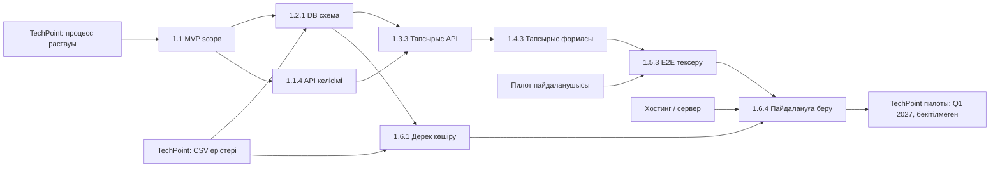

# Тәуелділіктер картасы

## Сыртқы тәуелділіктер (барлығы ұсынылған күндер)

| Не қажет | Кімнен | Растау күні | Қандай жұмыс бөгеледі | Б жоспары |
|---|---|---|---|---|
| TechPoint жұмыс процесінің қысқа сипаттамасы | Байкенов Оспан (байланыс тұлғасы) | 2026-10-30 | 1.1.1, 1.1.2, 1.3.3 | Шағын шеберханаға арналған үлгі сценариймен әзірлеу; бекітілмегенді белгілеу |
| Дерек өрістері / CSV үлгісі | TechPoint әкімшісі (тұлға анықталады) | 2026-11-06 | 1.2.1, 1.6.1 | Жасанды 20 жазбалы CSV дайындау; нақты жеке деректерді қолданбау |
| Тесттік хостинг не сервер мүмкіндігі | Хостинг жеткізушісі / TechPoint IT | 2026-11-13 | 1.2.4, 1.6.4 | Жергілікті Docker Compose және GitHub Actions пайдалану |
| Пилот пайдаланушысы мен кері байланыс | TechPoint өкілі (нақтылау қажет) | 2026-12-04 | 1.5.3, 1.6.3 | Команда ішіндегі рөлдік демонстрация және чек-парақ |

Күндер — команда бақылауы үшін ұсыныс; растау немесе келісім болғаны туралы мәлімдеме емес. `reminders.ics` файлында мерзімге 3 күн қалғанда ескерту берілген.
