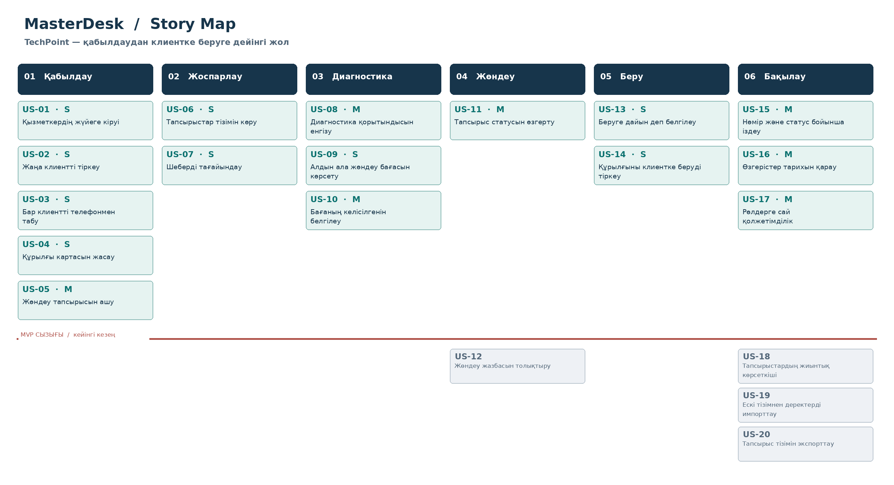

# MasterDesk — Story Map

> **Мәртебе:** 20.10.2026 күнгі TechPoint үшін ұсынылған талаптардың жұмыс нұсқасы; ресми бекіту күтіледі.

**Story Map қағидасы:** жоғарғы жол — қабылдау → жоспарлау → диагностика → жөндеу → беру → бақылау, ал төмендегі тармақтар құндылығына қарай орналасқан. Төмендегі MVP сызығы алғашқы сквозной пайдаланушы жолын бөліп көрсетеді.

## Қабылдау

- **MVP** — US-01: Қызметкердің жүйеге кіруі
- **MVP** — US-02: Жаңа клиентті тіркеу
- **MVP** — US-03: Бар клиентті телефонмен табу
- **MVP** — US-04: Құрылғы картасын жасау
- **MVP** — US-05: Жөндеу тапсырысын ашу

## Жоспарлау

- **MVP** — US-06: Тапсырыстар тізімін көру
- **MVP** — US-07: Шеберді тағайындау

## Диагностика

- **MVP** — US-08: Диагностика қорытындысын енгізу
- **MVP** — US-09: Алдын ала жөндеу бағасын көрсету
- **MVP** — US-10: Бағаның келісілгенін белгілеу

## Жөндеу

- **MVP** — US-11: Тапсырыс статусын өзгерту
- Кейін — US-12: Жөндеу жазбасын толықтыру

## Беру

- **MVP** — US-13: Беруге дайын деп белгілеу
- **MVP** — US-14: Құрылғыны клиентке беруді тіркеу

## Бақылау

- **MVP** — US-15: Нөмір және статус бойынша іздеу
- **MVP** — US-16: Өзгерістер тарихын қарау
- **MVP** — US-17: Рөлдерге сай қолжетімділік
- Кейін — US-18: Тапсырыстардың жиынтық көрсеткіші
- Кейін — US-19: Ескі тізімнен деректерді импорттау
- Кейін — US-20: Тапсырыс тізімін экспорттау

**Өңделетін нұсқалар:** `story-map.svg` (векторлық сурет) және `story-map.excalidraw` (Excalidraw ішіне импорттауға арналған файл). Сурет пен backlog бірдей `US-XX` идентификаторларын пайдаланады.
